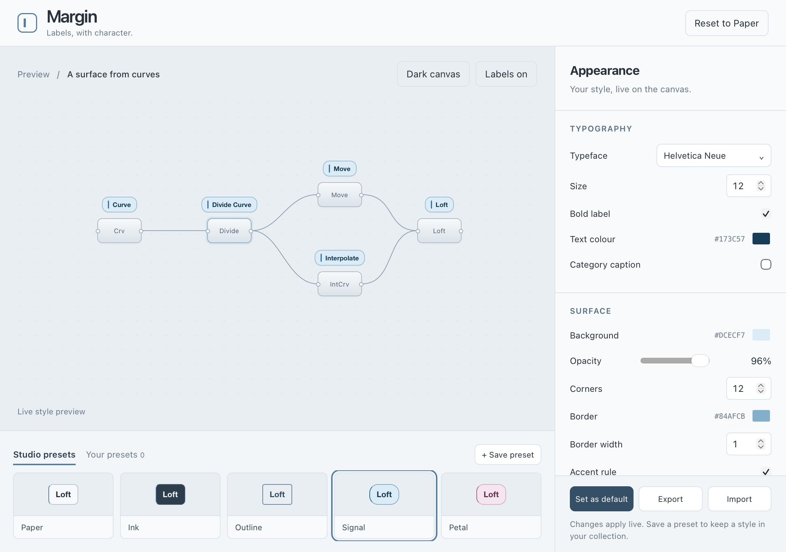

# Margin

**Labels and groups, with character.**

A visual label studio for Grasshopper: installed fonts, considered colour,
backgrounds, borders and spacing, with personal presets you can keep and reuse.
No extra component is added to your definition.

## Install

In Rhino 9, open **PackageManager**, enable **Include prereleases**, search for
**Margin**, and install **0.5.0-alpha.4**. Save your work before restarting Rhino.
In GH1 or GH2, choose **Display → Margin → Open Studio…** and turn labels on.
The label switch is saved automatically. It retains both ON and OFF across definitions, canvas recreation and Rhino restarts. Rendering errors can still pause a faulty overlay without changing that preference.

Rhino chooses the matching Mac or Windows package. Both Grasshopper adapters
are included; GH2 must also be available in your Rhino installation.

## Groups in the public alpha.4 preview

In GH1, create groups normally with **Cmd/Ctrl+G**, or use **Group selection** in Studio. Groups receive the designed frame automatically: a
larger internal heading, accent edge, and divider, distinct from component labels.
**Double-click the heading on the canvas** to edit its native name and colour.
Edits are undoable and saved in the Grasshopper file.

Studio offers eight vivid group presets: Cobalt, Orchid, Citrus, Lagoon, Ember,
Rose Pop, Blueprint and Ultraviolet. The previous eight colours remain in **Classics**.
Edit title colour (or use automatic contrast), size and weight, choose an editorial
rule, colour band or clean title, then adjust the fill, opacity, accent, border and
corners. Double-click editing also exposes title colour. Full group appearances
persist with the definition, undo/redo, and future-group defaults. Select a group on the canvas, choose a preset, and **Apply to group**
to update an existing group. **Use appearance for future groups** saves the colour,
opacity and styling choice on this computer, including for native Cmd/Ctrl+G groups.
Changing defaults does not recolour existing groups; pasted groups with explicit
colours keep them. Native background colours work with any canvas or workspace.
Component label presets, including Petal, remain independent.

In the public alpha.4 package, GH2 uses its existing group editor. GH1 stores
the group name, membership and fill in the native file. Margin supplies the
designed heading. Public alpha.4 has limited support for copying custom appearance.

0.5.0-alpha.4 is an experimental Package Manager prerelease. Mac GH1 group editing,
undo/redo, failure recovery and restart persistence have been tested live. Windows
packages compile; interactive Windows Rhino testing remains outstanding.

## Local alpha.7 group improvements

In the Mac GH2 candidate, **Use appearance for future groups** saves a style on
this computer. Both the native **Group** command and Studio’s **Group selection**
use it. Double-click a visible title to edit it. GH2 keeps its rectangular
frame, draggable edge and native group menu.

In GH1 and GH2, turn off **Show title** to remove the heading and its space.
The name and members stay with the group. To restore a hidden heading, open
the Groups tab, choose the group under **Edit group from this definition**,
enable **Show title** and click **Apply to group**.

The local alpha.7 build respects GH1's native **Box, Blob, Rectangles and None**
outline choices for drawing, selection and context menus. Box retains its internal
heading and decorative frame. Blob and Rectangles retain their native contours
with a heading above; None shows the heading without a frame. Bands, vertical
accents and corner controls apply to Box; their saved settings remain available
when switching back. Automatic title contrast follows the canvas for external headings.

Unnamed groups display **Group**, while their native names remain blank. Studio
keeps a selected unnamed group distinct from future defaults. Copy/paste preserves
custom appearance, title colour and casing within and between definitions; copies
remain independently editable. These changes are local development, not yet in the
public alpha.4 package. See the testing notes for current validation limits.

## Make it yours

Start with Paper, Ink, Outline, Signal or Petal. Search installed font families,
change the colour and surface treatment, or adjust spacing and visibility.
**+ Save preset** adds a style to **Your presets**, where it can be renamed,
updated or deleted. **Set as default** separately remembers the startup style.
Themes can also be exported and imported as JSON.

The Studio runs offline. Margin has no account requirement or telemetry.
No fonts are bundled. If an imported font is unavailable, an installed fallback
is used. GH1 and GH2 share the local preset library.

## Compatibility

| Platform | Grasshopper 1 | Grasshopper 2 |
| --- | --- | --- |
| macOS, Apple Silicon | Live-tested | Live-tested preview |
| Windows | Builds; Rhino runtime unverified | Builds; Rhino runtime unverified |

Use Rhino 9 with its .NET 10 runtime. The Mac build is tested against
9.0.26300.9402; Windows uses the 9.0.26300.9401 SDK. Older Rhino 9 builds may lack
required GH2 APIs. Rhino 8, .NET Framework mode and Linux are not supported.
This is an **experimental preview**, not a stable release. Windows testers are
welcome; an automated Windows build is not an interactive Rhino test.
See [testing status](docs/TESTING.md) for coverage and remaining limits.
A native Rhino/GH2 font-processing crash was reproduced on a large migrated
definition with Margin removed; the testing notes describe the evidence and
recovery workaround.

Your presets stay in your user account:

- Mac: `~/Library/Application Support/Margin/`
- Windows: `%APPDATA%\Margin\`

Uninstalling Margin does not remove `presets.json`, `theme.json` or `preferences.json`.
Disable other component-label overlays to avoid duplicated labels.

## Build and contribute

[Build instructions](release/BUILDING.md) · [Contributing](CONTRIBUTING.md) ·
[Report a bug](https://github.com/esolace/margin/issues) · [Changelog](CHANGELOG.md)

MIT licensed. Source, Studio design and the Margin icon are included under the
[MIT license](LICENSE). Rhino, Eto and operating-system libraries are supplied
by the host and are not redistributed. The Yak package includes a source archive.
