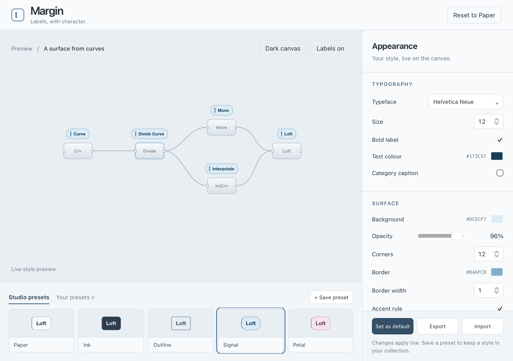

# Margin

**Labels and groups, with character.**

A visual label studio for Grasshopper: installed fonts, considered colour,
backgrounds, borders and spacing, with personal presets you can keep and reuse.
No extra component is added to your definition.

## Install

In Rhino 8.21 or newer (including Rhino 9), open **PackageManager**, enable **Include prereleases**, search for
**Margin**, and install **0.5.0-alpha.8**. Save your work before restarting Rhino.
In GH1 or GH2, choose **Display → Margin → Open Studio…** and turn labels on.
Margin remembers your label switch across files and Rhino restarts.

Rhino chooses the matching version and platform package. Rhino 8 includes
the Grasshopper 1 adapter. Rhino 9 includes both adapters; GH2 must also be
available in your Rhino installation.

## Groups

In GH1 and GH2, select components and use Grasshopper’s **Group** command
or **Group selection** in Studio. Choose a preset or adjust the fill, opacity,
title, border and accents. **Apply to group** updates the selected group.
**Use appearance for future groups** saves the default for new groups on this
computer, including after restarting Rhino.

Double-click a visible title to edit it. An unnamed Margin-styled group displays
**Group**. Turn off **Show title** to hide the entire heading and reclaim its
space. To bring it back, open Studio’s Groups tab, choose the group under
**Edit group from this definition**, enable **Show title**, and click **Apply to group**.

GH1 respects **Box**, **Blob**, **Rectangles** and **None**. GH2 keeps its native
rectangular frame, draggable edge and group menu. Copies retain their own
appearance within and between definitions, including after saving and reopening.

## Make it yours

Start with Paper, Ink, Outline, Signal or Petal. Search installed font families,
change the colour and surface treatment, or adjust spacing and visibility.
**+ Save preset** adds a style to **Your presets**, where it can be renamed,
updated or deleted. **Set as default** separately remembers the startup style.
Themes can also be exported and imported as JSON.

The Studio runs offline. Margin has no account requirement or telemetry.
No fonts are bundled. If an imported font is unavailable, an installed fallback
is used. GH1 and GH2 share the local preset library.

## Compatibility

| Host | Mac (Apple Silicon) | Windows |
| --- | --- | --- |
| Rhino 8.21+ · Grasshopper 1 | Tested on Rhino 8.37 | Experimental |
| Rhino 9 · Grasshopper 1 and 2 | Tested on Rhino 9 | Experimental |

The Rhino 8 package targets .NET 8 and the Rhino 8.21 SDK. Native testing uses
Rhino 8.37.26307.15002 with its bundled .NET 10 runtime; older Rhino 8 builds
have not been tested interactively. Update Rhino 8 if Margin does not appear.
Rhino 9 requires build 9.0.26300 or newer with .NET 10 for GH2 APIs.
.NET Framework mode and Linux are not supported. Windows builds and package
checks are automated; interactive Windows testing is pending.
See [testing status](https://github.com/esolace/margin/blob/main/docs/TESTING.md) for coverage and remaining limits.

Your presets stay in your user account:

- Mac: `~/Library/Application Support/Margin/`
- Windows: `%APPDATA%\Margin\`

Uninstalling Margin does not remove `presets.json`, `theme.json` or `preferences.json`.
Disable other component-label overlays to avoid duplicated labels.

## Build and contribute

[Build instructions](https://github.com/esolace/margin/blob/main/release/BUILDING.md) · [Contributing](https://github.com/esolace/margin/blob/main/CONTRIBUTING.md) ·
[Report a bug](https://github.com/esolace/margin/issues) · [Changelog](https://github.com/esolace/margin/blob/main/CHANGELOG.md)

MIT licensed. Source, Studio design and the Margin icon are included under the
[MIT license](LICENSE). Rhino, Eto and operating-system libraries are supplied
by the host and are not redistributed. The Yak package includes a source archive.
